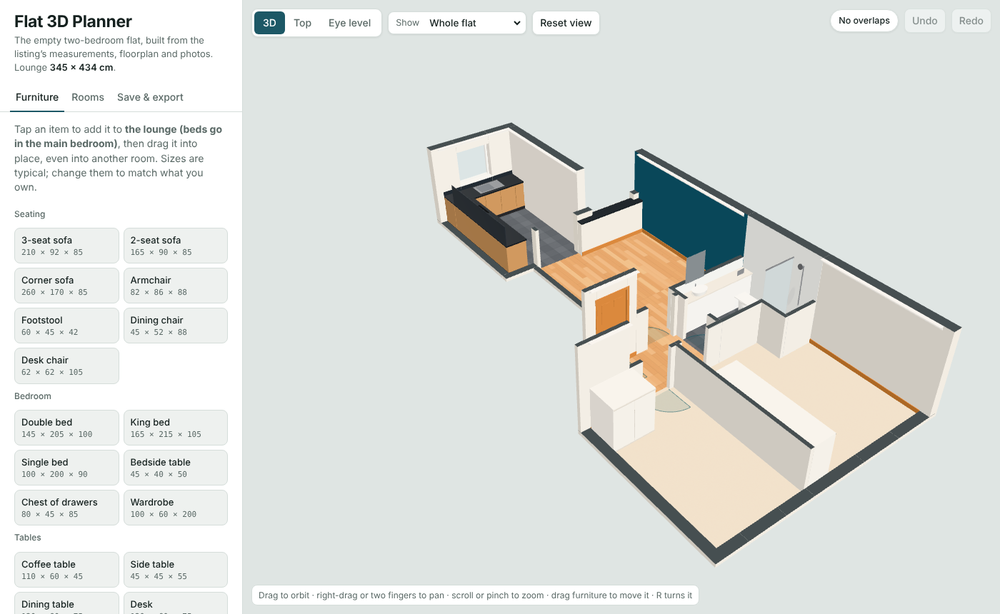

# Flat 3D Planner

A 3D model of the empty two-bedroom flat, built from the listing's measurements, floorplan and photos, with a furniture planner on top.

## Files

- `index.html` is the planner. Open it in a browser; it loads three.js from jsDelivr, so it needs an internet connection.
- `flat-empty.glb` is the empty flat as a standalone 3D model (glTF binary, metres, Y up), with each room as its own group. It opens in Blender, Windows 3D Viewer, most online glTF viewers, and SketchUp with a glTF importer. The origin is the lounge corner where the window wall meets the radiator wall.

## Rooms

| Room | Size | Source |
| --- | --- | --- |
| Lounge | 4.34 × 3.45 m (window wall to hall door, including the 25 cm door recess) | Listing |
| Kitchen | 3.43 × 2.29 m | Listing |
| Entrance hall | 2.54 × 1.30 m | Listing |
| Main bedroom | 3.89 × 3.53 m, with a built-in wardrobe along one wall | Listing, wardrobe from the plan |
| Second bedroom | 3.89 × 2.29 m, with a built-in wardrobe in the corner by the door | Listing, wardrobe from the plan |
| Shower room | 2.30 × 2.29 m, with the shower tray in a recess off the main bedroom | Listing, layout from the plan |
| Ceilings | 2.40 m | Estimate |

How the rooms fit together, and the positions of doors, windows, wardrobes and fittings, come from the floorplan and photos. Allow about ±10 cm on those.

Lounge details from the photos: the window and half-height ledge with a black top, the kitchen opening, the teal feature wall, the column radiator by the door, the glazed pine door, oak floor, coving and downlights.

## Using the planner

- **Show:** pick the whole flat or one room. In 3D, the chosen room keeps its far walls at full height and the rest of the flat is cut at 1.2 m so you can see in.
- **Furniture tab:** tap an item to add it to the room you're showing (beds go to the main bedroom when you're showing the whole flat). Drag it into place, even through a doorway into another room. The panel resizes, turns, recolours, duplicates or deletes it. Items snap to walls, and anything that overlaps furniture, a door swing, the radiator, a wardrobe or a fitting turns red.
- **Rooms tab:** room sizes, the lounge's dimensions, wall colours per room, floors and woodwork.
- **Views:** 3D, Top (a plan cut at 1.2 m with room sizes) and Eye level, where you can walk through the doorways from room to room.
- **Save & export:** save or open a layout file, download the flat as a .glb (empty or furnished), or save a picture.

Your layout is also kept in the browser as you go.
